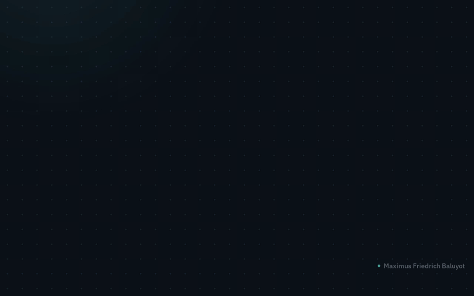

# Content Ops Assistant

## Demo
<!-- demo:auto -->

Full walkthrough with captions: [demo/demo.mp4](demo/demo.mp4) (66 s, 1280x800, animated intro and end card). Run it yourself: `just setup && just up`, then open http://localhost:8116/.

Two-minute walkthrough:
1. Content ops: use the sample brief, the Ledger Sync launch
2. Generate: email, LinkedIn and ad copy from one brief
3. The LinkedIn version
4. The ad copy
5. The system prompt the sliders produce
6. Move the tone slider to Friendly: the prompt changes with it
7. Formality up three notches: a formal register rule appears
8. Generate again with the new voice
<!-- /demo:auto -->

## Brief
A marketing team rewrites the same launch brief for email, LinkedIn and ads, for different personas, and the tone
drifts between writers. This assistant takes one brief, applies brand settings (tone, formality, length, persona,
banned words) and writes every channel from the same prompt. Solved means a full channel set in seconds with a
guardrail the team can read and adjust rather than a prompt hidden in code.

## Tech stack
| Layer | Choice | Why |
|---|---|---|
| Language and runtime | Python 3.11 via uv | same as the rest of the portfolio |
| Model or core logic | `BrandSettings` -> `build_system_prompt`; `common/llm.py` `complete` per channel | prompt is data, provider by env, deterministic offline copy |
| Interface | Streamlit with `common/streamlit_theme.py` | sliders in the sidebar, prompt and copy side by side; `key="input"`, `key="run"` |
| Data | `SAMPLE_BRIEF` (a feature launch with concrete numbers) | one click to a result |
| Tests | pytest (5) incl. `AppTest` smoke | prompt logic, clamping, offline determinism, UI happy path |

## Libraries used
`streamlit` (UI, tabs, download button), `anthropic` / `openai` / `google-genai` (providers behind the shared door),
`pytest`, `ruff`. No other runtime dependency.

## How it was built
1. Read the original `app.py`: a one-line f-string prompt per channel sent to OpenAI, a text banner instead of copy
   when no key, and an "Export to CSV" button that only showed a success message.
2. Split the logic into `content.py`: `BrandSettings` (tone, formality 0-10, length, persona, banned words),
   `build_system_prompt`, per-channel format rules, and `generate`.
3. Replaced the OpenAI call with `common.llm.complete`; added deterministic offline placeholder copy built from the
   brief and sliders, labelled `[OFFLINE PLACEHOLDER <hash>]`.
4. Built the page: sidebar sliders, the live system prompt under the brief, Use sample, Generate, one tab per
   channel, a real Markdown download, and a provider badge.
5. Tests (prompt reflects sliders, clamping, determinism, validation, `AppTest` sample -> Generate), ruff, just
   recipes with a pid file.

## Results
No numeric score; the brand guardrail is the visible prompt. The tests prove that every slider changes the prompt
(`Bold` + formality 9 + `Short` vs `Witty` + 1 + `Long` give different prompts with the matching register and word
budget), that offline output is identical across runs and changes when a slider changes, and that the UI reaches
three filled output tabs from one click. With a key, a full set (three sequential Haiku calls) takes a few seconds,
in line with the original under-15-seconds claim.

## Demo details
- Run: `just content_ops_assistant-setup && just content_ops_assistant-up`, open `http://localhost:8116/`.
- Two-minute walkthrough: (1) badge; (2) Use sample, read the prompt box; (3) set Tone to Bold and Formality to 2,
  watch the prompt change; (4) Generate, open the three tabs, download the Markdown.
- Video clip: `demo/clips/portfolio__content_ops_assistant.webm`.
- Sample inputs: `SAMPLE_BRIEF` in `content.py` (the "Ledger Sync" launch). Offline, each tab starts with an
  `[OFFLINE PLACEHOLDER ...]` line and a subject line built from the first sentence of the brief.

## Limits and next steps
- Offline copy is a template, not writing; it exists so the demo runs with no key.
- No automated tone or brand score; an LLM-as-judge check against the shown prompt is the next step.
- The three channel calls run one after another; parallelising them is a small change.
- Human review stays in the loop for anything that ships; the download is Markdown, not a CMS push.
